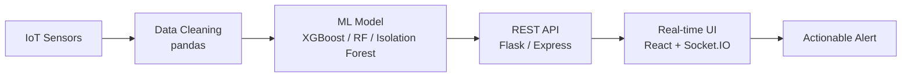

<!-- HEADER -->
<p align="center">
  
</p>

<p align="center">
  
</p>

---

## `~/about.py`

```python
class Bhakti:
    role      = ["Full-Stack Developer", "ML Engineer"]
    focus     = "backend logic, model integration, real-time systems"
    education = "B.Tech CSE, Sharad Institute of Technology (2027)"
    base      = "Maharashtra, India"

    stack = {
        "web":  ["React", "Node.js", "Express", "Flask", "Socket.IO"],
        "data": ["MongoDB", "MySQL", "pandas"],
        "ml":   ["scikit-learn", "XGBoost", "Random Forest", "CNN", "Isolation Forest"],
    }

    def philosophy(self):
        return "A model nobody can call is a notebook. Ship it behind an API."

    def now(self):
        return ["IoT + ML systems", "React deep-dive", "DSA on LeetCode",
                "open source", "Full-Stack internship hunt"]
```

---

## `~/projects/` — what I've shipped

| Project | What it does | Stack |
|---|---|---|
| 🩺 **[DialySenseAI](https://github.com/bhaktiyadav08/DialySenseAI)** | Predictive maintenance for dialysis machines using IoT sensor data, so failures are flagged before they happen | `Python` `ML` `IoT` |
| 📚 **[PageTurner AI](https://github.com/bhaktiyadav08/PageTurner-AI)** | AI-powered bookstore with smart recommendations | `Full-Stack` `AI` |
| 🤝 **[ProjectHub](https://github.com/bhaktiyadav08/ProjectHub)** | Real-time project collaboration platform (live updates over sockets) | `Node` `Express` `MongoDB` `Socket.IO` `React` |
| 🗳️ **[Ballotly](https://github.com/bhaktiyadav08/Ballotly)** | Polling and voting web app | `React` |
| 🌐 **Hariom Diagnostics** | Live client website, deployed on Render, tuned for SEO and PageSpeed | `Web` `Render` `SEO` |

---

## `~/experience.log`

```text
[2026-03 → 2026-06]  Deep Learning Intern @ UptoSkills (SyncAura AI)
                     └─ backend logic + model integration
                     └─ resolved data redundancy across 3+ datasets (15,000+ data points)

[2025-06 → 2025-07]  Web Development Intern @ ArrayLogics Softwares, Pune
                     └─ full-stack web development
```

---

## `~/requirements.txt`

<p align="center">
  
</p>

<p align="center">
  
  
  
  
  
</p>

---

## `~/pipeline.mmd` — how I think about systems



---

## `~/stats.json`

<p align="center">
  
  
</p>

<p align="center">
  
</p>

---

## `~/certs.txt`

`AWS` AI-Powered HR Assistant (GenAI) &nbsp;·&nbsp; `IBM` LLMs to Work with Data &nbsp;·&nbsp; `Google` Analytics

---

## `~/contact.sh`

<p align="center">
  <a href="https://linkedin.com/in/bhaktiyadav">
    
  </a>
</p>

<p align="center"><code>$ open_to --internships "Full-Stack" "ML"</code></p>


